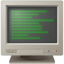

# stdout-mcp

> Let coding agents reload your Chrome extension and read its console logs, without keeping its service worker awake

`stdout-mcp` has three parts:

- **`stdout()`**, an import you call from your extension to forward its console output to the `stdout-mcp` extension.
- **The `stdout-mcp` extension**, which you load unpacked in Chrome or Edge.  It stores the last 10,000 messages and shows them in its own console.
- **An [MCP](https://modelcontextprotocol.io) server** that lets your coding agent read those messages and reload the extension.


## Why?

A Manifest V3 extension often does most of its work in a service worker that Chrome shuts down after about 30 seconds, once it's stopped getting events.  Then Chrome starts it again for the next event.  Bugs often hide in that restart flow: state kept in a variable is gone, or a listener isn't registered in time.

You can inspect the service worker's console, but while that devtools window is open, Chrome keeps the worker running.  So you'll never see your extension go from active to inactive and back again, preventing you from reproducing a bug your users might see.  `stdout-mcp` collects your console output in a separate extension, so the worker in your own extension can stop and start just as it would in production.

Coding agents have it worse.  They can't see your extension's console at all, so they ask you to copy the logs and to click reload after every change.  With the `stdout-mcp` server, an agent can:

- read what your extension logged, including messages from before the agent session started
- add a marker to the logs, then ask you to reproduce a problem and wait for the new messages to come in
- reload your extension after changing its code, and tell whether it came back up successfully

[Why not Chrome DevTools MCP?](#why-not-chrome-devtools-mcp)


## Installation

```shell
npm install --save-dev stdout-mcp
```

Then load the `stdout-mcp` extension in your browser:

1. Open `chrome://extensions` (or `edge://extensions` in Edge) and turn on **Developer mode**.
2. Click **Load unpacked** and choose the `/path/to/your/extension/node_modules/stdout-mcp/extension` folder, or drag that folder onto the page.

To see your extension's console output, click the <u>service worker</u> link in the `stdout-mcp` card on the Extensions page.  To let an agent read it, see [Reading logs from a coding agent](#reading-logs-from-a-coding-agent) below.


## Usage

To send logs from your extension, import `stdout()` from the package and call it:

```js
// service-worker.js
import stdout from "stdout-mcp";

stdout();
console.log("my important message", { hello: "world" });
```

By default, the global `console` object will be wrapped with methods that forward to the `stdout-mcp` extension, so anything passed to `console.log()`, `console.error()`, etc. in your extension will also be displayed in the `stdout-mcp` extension's service worker console.  Calls to `console.error()` appear there as warnings labeled `error`, so they aren't listed as errors for the `stdout-mcp` extension itself.  The source link at the end of each line points to `stdout-mcp`'s own code, not to the line in your extension that logged the message.

Call `stdout()` once on each "page" in your extension from which you want to send console output: the service worker, the popup, content scripts, etc.  To turn console forwarding off, such as for a production build, you can pass the [`enabled`](#enabled) flag with `false`, or just use an `if` statement to make the call only in development.


## Reading logs from a coding agent

The package includes an [MCP](https://modelcontextprotocol.io) server, `stdout-mcp`, that lets a coding agent read your extension's console output.  It needs no other changes to your extension.

The `stdout-mcp` extension stores the last 10,000 log messages it receives, whether or not an agent is connected.  So when you notice something going wrong and start an agent session, the agent can see what was logged beforehand.


### Setup

Add the server to your agent's MCP configuration.  Node 20 or later needs to be installed.

For **Claude Code**, run this in your extension's project:

```shell
claude mcp add stdout -- npx stdout-mcp
```

Or add it to the project's `.mcp.json`:

```json
{
  "mcpServers": {
    "stdout": {
      "command": "npx",
      "args": ["stdout-mcp"]
    }
  }
}
```

For **Codex**, run:

```shell
codex mcp add stdout -- npx -y stdout-mcp
```

Or add it to `~/.codex/config.toml`:

```toml
[mcp_servers.stdout]
command = "npx"
args = ["-y", "stdout-mcp"]
```

When called by an agent, the MCP server starts a small background process on port 47321 that holds the logs, runs the tools, and is shared by all agent sessions.  The background process exits after two hours without use.  See [docs/architecture.html](docs/architecture.html) for how these pieces fit together.


### Enabling agent mode

To let the `stdout-mcp` extension send its logs to the MCP server, click its icon in Chrome's toolbar.  (You may need to pin it from the Extensions menu first.)  The icon shows an **MCP** badge while agent mode is on.  The badge is gray until an agent session starts and has received the logs, when it turns green.  It turns gray again two hours after an agent stops using it.

Click the icon again to turn agent mode off.  The logs are still stored and shown in the `stdout-mcp` extension's console, but nothing is sent to the local MCP server.


### More than one browser

The `stdout-mcp` extension can send logs from more than one browser at once, such as Chrome and Edge, or two Chrome profiles.  Turn on agent mode in each one to use them simultaneously.  When logs come from more than one browser, each message says which one it came from, and the agent can limit what it reads to one browser.  `reload_extension` reloads an extension in the browser it has logged from, and asks which one when it has logged from several.

Each browser is named by its brand and version, like `Edge 146`.  Chrome's channels all call themselves Chrome, so to tell Chrome and Canary apart, give one of them a name by right-clicking the `stdout-mcp` icon, choose **Options**, and enter a name like `Canary` in the **Browser name** field.


## `stdout-mcp` Tools

| Tool | Description |
|------|-------------|
| `get_logs` | Returns the most recent log messages, the messages after a cursor from a previous call, or the messages around a given one.  Can filter by level, extension, browser, filename, a regular expression, or how recent the messages are, like `10m`. |
| `wait_for_log` | Waits for a new log message that matches a regular expression, such as after the agent asks you to reproduce a problem. |
| `mark` | Adds a line to the log, such as before the agent asks you to reproduce a problem, so the messages that follow are easy to find. |
| `reload_extension` | Reloads an unpacked extension so it runs your latest code, even if its service worker failed to start.  It only works on extensions that have called `stdout()`.  If the extension is in more than one browser, pass `browser` to say which.  With `reloadManifest: true`, it also reads `manifest.json` again and says whether the extension came back.  That needs `stdout()` to be called when your service worker starts, and a service worker that can start successfully. |
| `list_sources` | Lists the browsers the `stdout-mcp` extension is sending logs from and when each last connected, and the extensions and pages that have sent logs. |

Times are shown in your local time zone, like in the `stdout-mcp` extension's console, and each message shows the time since the previous one, like `+251ms`.  A `loaded` line marks the first message from each page load, so you can see when a service worker restarted or a popup was reopened.


## `stdout()` Options

You can pass `stdout()` an object with any of these options:


### `enabled`

Set `enabled` to `false` to make `stdout()` silently do nothing.  It defaults to `true`.  Use an environment variable or something similar to send logs in development but not in production:

```js
stdout({ enabled: process.env.NODE_ENV !== "production" });
```


### `wrapConsole`

If you don't want to wrap the global `console` object, set `wrapConsole` to `false`.  In that case, `stdout()` will return an object with the standard console methods that you can call when you want to send console output to the `stdout-mcp` extension:

```js
const { log, error } = stdout({ wrapConsole: false });

console.log("this message will not be sent to stdout-mcp");
log("this message will be logged locally *and* sent to stdout-mcp", { hello: "world" });
error("so will this error", new Error("something went wrong"));
```


### `filename`

In the `stdout-mcp` extension's service worker console, the filename of your extension page is prefixed to each line of output, since different parts of your extension can all send messages to that console.  By default, this filename is extracted from `location.pathname`.  In a content script, where `location` is the web page's, it defaults to `content:` plus the page's host, like `content:example.com`.  You can specify a custom name by passing a `filename` field in the options object:

```js
// service-worker.js
stdout({ filename: "background" });

// popup.html
stdout({ filename: "toolbar" });
```


## Content scripts

A content script normally runs in an isolated world: it shares the page's DOM, but not its JavaScript globals.  So `stdout()` wraps only your content script's `console`.  The page's own `console` isn't changed, and its messages aren't sent to the `stdout-mcp` extension.

All of your extension's content scripts in a frame share one isolated world, so only the first `stdout()` call there wraps `console`, even if each script is bundled with its own copy of `stdout-mcp`.  Later calls return the same methods and ignore their options, so messages from all of those scripts use the first call's `filename`.

A content script in the page's `MAIN` world can't use extension APIs, so `stdout()` does nothing there and returns the page's `console`.


## Why not Chrome DevTools MCP?

[Chrome DevTools MCP](https://github.com/ChromeDevTools/chrome-devtools-mcp) lets an agent drive a browser: open pages, click, take screenshots, read a page's console, and inspect extensions.  It can launch its own browser or attach to the one you're using.  That's powerful, but it has some important drawbacks when you're debugging an extension you're also actively using:

- **DevTools MCP keeps your service worker awake.**  Your extension's service worker won't go idle while the MCP is connected, whether it attached to your normal browser or launched its own.  Like with an open devtools window, this means you won't see the normal worker restart cycles where bugs can hide.  `stdout-mcp` never attaches directly to your extension.
- **DevTools MCP only sees what happens while it's connected.**  `stdout-mcp` stores messages whether or not an agent is running, so an agent can look into a problem you noticed before you started the session.  Chrome DevTools MCP only sees what happens from the time it connects, so you'll still have to copy and paste logs (if you're lucky and the worker hasn't been closed yet...).
- **DevTools MCP gets your whole browser.**  Attached to the browser you use every day, it can see and control every tab, including the sites you're signed in to.  `stdout-mcp` only knows about the extensions where you've added the `stdout()` call, and it can only reload those.

Keep Chrome DevTools MCP for automated tests, but use `stdout-mcp` as your daily driver.


## License

[MIT](./LICENSE) © [John Dunning](https://github.com/fwextensions)
